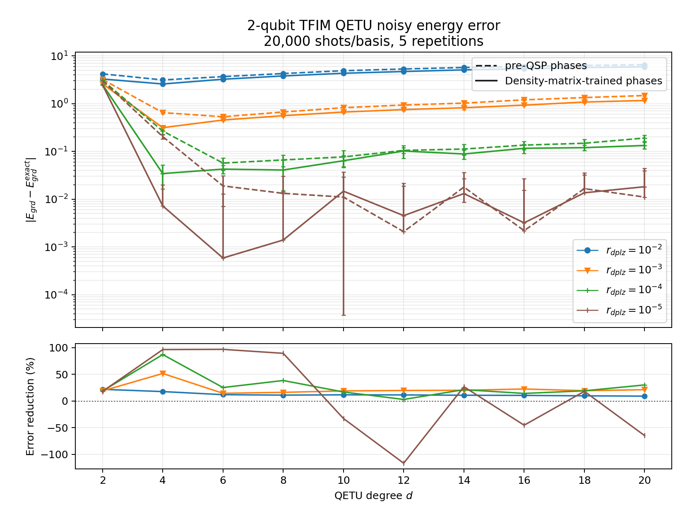
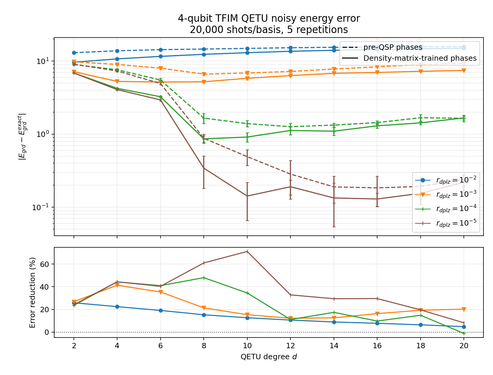

# VQE-QETU Density-Matrix Phase Training

This repository trains QETU phase factors directly with a differentiable
PyTorch density-matrix simulator. The objective is the postselected energy,
so the phases are optimized for the noisy QETU circuit instead of first being
fitted to a target polynomial by QSPPACK.

The current reportable benchmark is intentionally focused:

- open-boundary transverse-field Ising model (TFIM), `g=4`;
- `n=2` and `n=4` system qubits;
- even QETU degrees `d=2,4,...,20`;
- exact spectral scaling to `[eta, pi-eta]`, with `eta=0.1`;
- QETU-main's TFIM control-free circuit convention;
- gate-wise depolarizing rates `0, 1e-5, 1e-4, 1e-3, 1e-2`;
- paired pre-QSP and variational-phase evaluation with identical simulator
  seeds, 20,000 shots per measurement basis, and five repetitions.

This is a small research implementation for the supported TFIM benchmark. It
does not replace [QETU](https://github.com/qsppack/QETU) or
[QSPPACK](https://github.com/qsppack/QSPPACK).

## Method

The full noisy density-matrix evolution is implemented with PyTorch complex
tensors:

```text
rho -> U(phi) rho U(phi)^dagger
rho -> sum_k K_k rho K_k^dagger
```

After the QETU circuit, the ancilla-zero block is postselected:

```text
rho0_unnormalized = <0| rho |0>
p0 = Tr(rho0_unnormalized)
rho0 = rho0_unnormalized / p0
loss = Re Tr(H rho0)
```

The QETU phases are `torch.nn.Parameter` values. PyTorch therefore
differentiates the exact noisy expectation value without shot noise during
training. Each scan point uses three random restarts, 25 Adam basin-finding
steps, and adaptive L-BFGS polishing. All `d+1` phases are trainable; pre-QSP
phases are used only as the comparison baseline.

The final comparison has two layers:

1. Exact density-matrix evaluation with gate noise but no shot noise.
2. QETU-main/Qiskit Aer evaluation with the same phases, gate noise, 20,000
   shots per basis, and five repetitions.

The ancilla-zero success probability is reported separately. Because the
energy-only objective has no success-probability penalty, a low-`p0` solution
is possible and can require many shots for a stable postselected estimate.

## Results

The committed result snapshots are in `report_results/`; large per-point
histories and PyTorch checkpoints remain under the git-ignored `results/`
directory.

Median paired finite-shot error reduction from density-matrix-trained phases:

| system | `1e-5` | `1e-4` | `1e-3` | `1e-2` |
|---|---:|---:|---:|---:|
| TFIM `n=2` | 18.1% | 20.2% | 19.6% | 11.3% |
| TFIM `n=4` | 31.2% | 20.5% | 19.8% | 11.6% |

These percentages compare the two phase methods at the same degree and noise
rate, then take the median over `d=2,...,20`. At very low noise, finite-shot
fluctuations and low postselection probability can dominate individual
points, so the exact-density and finite-shot plots should be read together.
The improvement is a median trend, not uniform dominance at every scan point.

One noiseless `n=4`, `d=4` trained solution has
`p(ancilla=0)=8.93e-5`; only three of five 20,000-shot repetitions contained
postselected samples in both measurement bases. This point is retained in the
machine-readable results but is excluded from the noisy-only report figures.

### Finite-Shot Evaluation

The two report figures below use 20,000 shots per measurement basis and five
independent repetitions. They show only the noisy rates
`1e-5, 1e-4, 1e-3, 1e-2`; the noiseless curve is intentionally omitted.

#### Two-Qubit TFIM



#### Four-Qubit TFIM



In the plots, dashed lines are pre-QSP phases and solid lines are phases
trained directly in the noisy density-matrix model. Positive error reduction
means the variational phases improve on pre-QSP at the same scan point.

## Repository Layout

```text
config/                         n=2/n=4 training and evaluation configs
figures/                        report figures
report_results/                 compact, portable result snapshots
density_simulator.py            differentiable gates and Kraus channels
tfim.py                         TFIM Hamiltonian and exact spectral scaling
qetu_density.py                 differentiable QETU circuit model
trainer.py                      Adam and adaptive L-BFGS optimization
train_density_matrix.py         focused single-run entry point
train_degree_scan.py            degree/noise scan entry point
qiskit_validation.py            QETU-main and Aer validation
evaluate_pre_qsp_vs_density.py  paired finite-shot reevaluation
plot_pre_qsp_vs_density.py      report plotting
export_report_results.py        portable result-snapshot export
run_density_matrix_checks.py    smoke and cross-validation checks
```

## Environment

The expected workspace layout is:

```text
workspace/
  QETU-main/
  VQE-QSP/
  VQE-QSP-Density-Matrix/
```

`QETU-main` supplies the reference Qiskit circuit and finite-shot measurement
helpers. `VQE-QSP` is the preceding local benchmark project and supplies the
pre-QSP phase scans. Neither dependency is copied into this repository; the
portable result snapshots are sufficient for plotting the committed results.

Create the environment:

```powershell
conda env create -f environment.yml
conda activate vqe_qsp_dm
```

Run the checks before starting a long scan:

```powershell
python run_density_matrix_checks.py
```

The checks also verify that the committed n=2/n=4 snapshots are complete,
portable, use paired simulator seeds, and contain the same trained phases as
the corresponding training summaries.

Regenerate the report figures directly from the committed snapshots:

```powershell
python plot_pre_qsp_vs_density.py --result report_results/tfim_n2_pre_qsp_comparison_shot20000.yml
python plot_pre_qsp_vs_density.py --result report_results/tfim_n4_pre_qsp_comparison_shot20000.yml
```

## Reproduce The Scans

Two-qubit TFIM:

```powershell
python train_degree_scan.py --config config/dm_tfim_n2_degree_scan_optimized.yml --overwrite
python evaluate_pre_qsp_vs_density.py --config config/compare_pre_qsp_density_optimized_shot20000.yml --overwrite
python plot_pre_qsp_vs_density.py --result results/pre_qsp_vs_density_optimized_shot20000/comparison_shot20000.yml
```

Four-qubit TFIM:

```powershell
python train_degree_scan.py --config config/dm_tfim_n4_degree_scan_optimized.yml --overwrite
python evaluate_pre_qsp_vs_density.py --config config/compare_pre_qsp_density_n4_optimized_shot20000.yml --overwrite
python plot_pre_qsp_vs_density.py --result results/pre_qsp_vs_density_n4_optimized_shot20000/comparison_shot20000.yml
```

Interrupted scans and evaluations can continue with `--resume` instead of
`--overwrite`. Completed scan points are skipped.

Refresh the compact report snapshots after rerunning both benchmarks:

```powershell
python export_report_results.py
```

## Scope And Limitations

- Training uses exact noisy density matrices and therefore scales
  exponentially with the total number of qubits.
- The supported circuit mirror is the QETU-main TFIM control-free path.
- The depolarizing model is gate-wise and uses the same convention in PyTorch
  and Aer validation.
- Exact spectral bounds are used for these small benchmark systems.
- Finite-shot energy is a conditional estimator and becomes unstable when
  the ancilla-zero success probability is very small.
